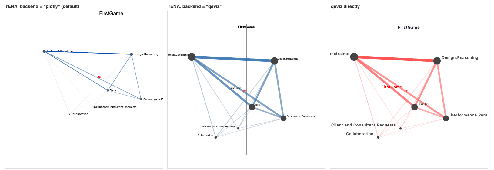
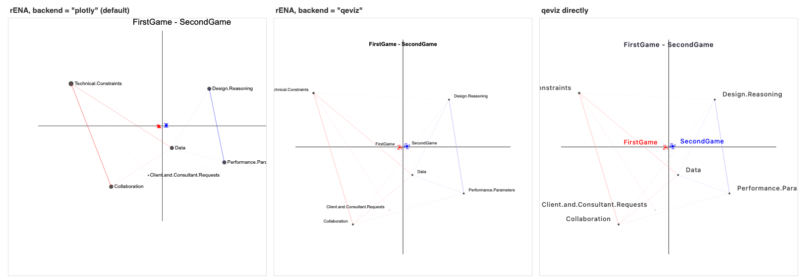
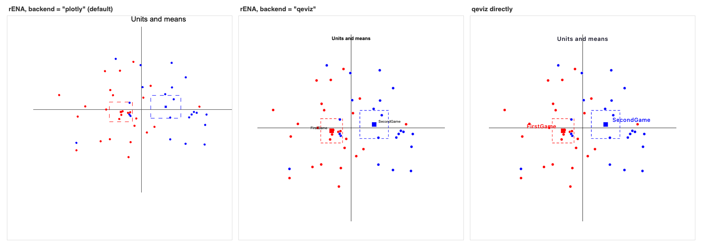

# Plot backends: plotly and qeviz

rENA draws plots with **plotly** (the default) or **qeviz**, the library
behind webENA's network plots. Existing plotting code works on either: add
`backend = "qeviz"` to `ena.plot()`, or set it for the session with

```r
options(rENA.plot.backend = "qeviz")
```

qeviz (>= 0.5.0) installs from qe-libs.org:

```r
install.packages("qeviz", repos = c("https://cran.qe-libs.org", "https://cran.rstudio.org"))
```

Below, each view is drawn three ways from RS.data: the rENA code with each
backend (only `backend` differs), and the same view written with qeviz's own
functions, which take the ENA set directly. The full list of differences is in
the `?rENA-plot-backends` help page.

All three use this setup:

```r
library(rENA)
data(RS.data)
codeNames <- c("Data", "Technical.Constraints", "Performance.Parameters",
  "Client.and.Consultant.Requests", "Design.Reasoning", "Collaboration")
accum <- ena.accumulate.data(
  units = RS.data[, c("Condition", "UserName")],
  conversation = RS.data[, c("Condition", "GroupName")],
  codes = RS.data[, codeNames],
  window.size.back = 4
)
set <- ena.make.set(accum)
first  <- set$meta.data$Condition == "FirstGame"
second <- set$meta.data$Condition == "SecondGame"
lw  <- as.matrix(set$line.weights)
pts <- as.matrix(set$points)
```

## A group's network and its mean

[](https://gitlab.com/epistemic-analytics/qe-packages/rENA/-/raw/main/man/figures/backends-network.png)

*Click the figure for full size.*

On qeviz, line width is absolute per weight and each node's size is the sum of its edge widths, so separate plots of one model are directly comparable.

**rENA** (`backend` is `"plotly"` or `"qeviz"`):

```r
p <- ena.plot(set, title = "FirstGame", backend = backend)
p <- ena.plot.network(p, network = colMeans(lw[first, ]))
p <- ena.plot.group(p, pts[first, ], labels = "FirstGame", colors = "red",
                    confidence.interval = "box")
```

**qeviz directly:**

```r
p <- qe_plot(set, title = "FirstGame", group_col = "Condition",
             scale_points = FALSE, range = "network") |>
  qe_axes() |>
  qe_colors(FirstGame = "#FF0000") |>
  qe_edges(group = "FirstGame") |>
  qe_group("FirstGame")
```

## A subtraction with both means

[](https://gitlab.com/epistemic-analytics/qe-packages/rENA/-/raw/main/man/figures/backends-subtraction.png)

*Click the figure for full size.*

Colour and width are on the model-wide scale, so the small differences in a subtraction draw lighter than a group's network; `multiplier` (rENA) or `magnify` (qeviz) enlarges them.

**rENA** (`backend` is `"plotly"` or `"qeviz"`):

```r
p <- ena.plot(set, title = "FirstGame - SecondGame", backend = backend)
p <- ena.plot.network(p, network = colMeans(lw[first, ]) - colMeans(lw[second, ]),
                      colors = c("red", "blue"))
p <- ena.plot.group(p, pts[first, ], labels = "FirstGame", colors = "red",
                    confidence.interval = "box")
p <- ena.plot.group(p, pts[second, ], labels = "SecondGame", colors = "blue",
                    confidence.interval = "box")
```

**qeviz directly:**

```r
p <- qe_plot(set, title = "FirstGame - SecondGame", group_col = "Condition",
             scale_points = FALSE, range = "network") |>
  qe_axes() |>
  qe_colors(FirstGame = "#FF0000", SecondGame = "#0000FF") |>
  qe_edges(group = "FirstGame", compare = "SecondGame") |>
  qe_group("FirstGame", "SecondGame")
```

## Units and means

[](https://gitlab.com/epistemic-analytics/qe-packages/rENA/-/raw/main/man/figures/backends-points.png)

*Click the figure for full size.*

Each mean keeps its own confidence interval.

**rENA** (`backend` is `"plotly"` or `"qeviz"`):

```r
p <- ena.plot(set, title = "Units and means", scale.to = "points", backend = backend)
p <- ena.plot.points(p, pts[first, ], colors = "red")
p <- ena.plot.points(p, pts[second, ], colors = "blue")
p <- ena.plot.group(p, pts[first, ], labels = "FirstGame", colors = "red",
                    confidence.interval = "box")
p <- ena.plot.group(p, pts[second, ], labels = "SecondGame", colors = "blue",
                    confidence.interval = "box")
```

**qeviz directly:**

```r
p <- qe_plot(set, title = "Units and means", group_col = "Condition",
             scale_points = FALSE, range = "points") |>
  qe_axes() |>
  qe_colors(FirstGame = "#FF0000", SecondGame = "#0000FF") |>
  qe_edges(show = FALSE) |>
  qe_points() |>
  qe_group("FirstGame", "SecondGame")
```

---

Generated by `data-raw/plot-backends-figures.R`; re-run it after changing
either backend.
